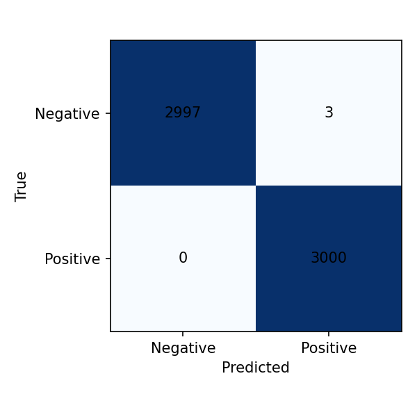

# Concrete Crack Classifier


Binary image classification (crack/no crack) of concrete surfaces using transfer learning with ResNet-18 in PyTorch.

**Status:** baseline complete. Generalisation testing planned (see Issues).

#Motivation
Manual inspection of concrete structures is slow and subjective. This project explores how a pretrained CNN can detedt surface cracks automatically.

#Dataset
Concrete crack images for classification (~40,000 images, 227x227 px, two classes: Positive /Negative). Not included in this repo. Download from Kaggle (see 'notebooks/').

##Project Structure
-`notebooks/` exploration and experoments
-`src/` reusable training code
-`configs/` hyperparameters
-`results/` plots and metrics

## How to reproduce
1. Create a Kaggle notebook with a GPU accelerator and Internet on.
2. Add the "Surface Crack Detection" dataset as an input.
3. Clone this repo and install requirements:
   ```bash
   git clone https://github.com/rizvi66/crack-classifier.git
   cd crack-classifier
   pip install -r requirements.txt
   ```
4. Set `data_dir` in `configs/config.yaml` to the folder containing `Positive/` and `Negative/`.
5. Train and evaluate:
   ```bash
   python src/train.py --config configs/config.yaml
   ```
6. Generate Grad-CAM heatmaps:
   ```bash
   python src/gradcam.py --weights /path/to/best.pt
   ```

Training takes a few minutes on a Kaggle T4/P100 GPU. Weights are not stored in the repo.

## Results
## Results

ResNet-18 (ImageNet-pretrained), 2 epochs head-only training then 6 epochs full fine-tuning. Best checkpoint by validation loss (epoch 6). Test set: 6,000 images (3,000 per class), never used during training or model selection.

| Class | Precision | Recall | F1 | Support |
|---|---|---|---|---|
| No crack | 1.0000 | 0.9990 | 0.9995 | 3000 |
| Crack | 0.9990 | 1.0000 | 0.9995 | 3000 |

Overall test accuracy: **99.95%** (3 errors out of 6,000: 3 false alarms, 0 missed cracks).




### Limitations
The dataset consists of patches cropped from a small number of large photographs. A random split can place patches from the same photograph in both train and test sets, so these scores are likely optimistic. Performance on images from new structures, cameras or lighting conditions has not yet been measured.


**Observations:** On the 6,000-image test set, 3 images were misclassified (all labelled "no crack" but predicted "crack"). Grad-CAM shows the model's attention on dark, linear features in these images; in at least two of them a crack-like line is visible, suggesting possible label noise in the dataset rather than a model failure. One prediction was low-confidence (0.575). Manual inspection of the original images is needed to confirm.