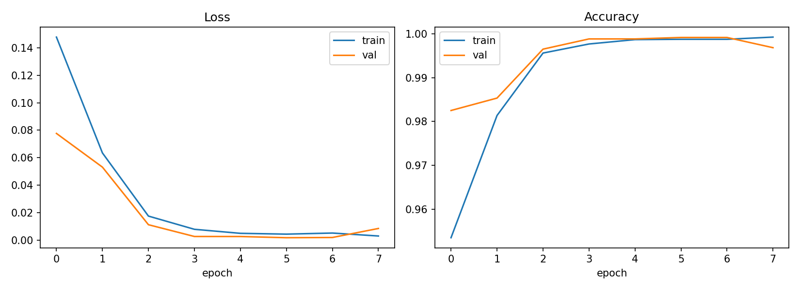

# Concrete Crack Classifier
Binary image classification (crack/no crack) of concrete surfaces using transfer learning with ResNet-18 in PyTorch.

**Status:** in progress

#Motivation
Manual inspection of concrete structures is slow and subjective. This project explores how a pretrained CNN can detedt surface cracks automatically.

#Dataset
Concrete crack images for classification (~40,000 images, 227x227 px, two classes: Positive /Negative). Not included in this repo. Download from Kaggle (see 'notebooks/').

##Project Structure
-`notebooks/` exploration and experoments
-`src/` reusable training code
-`configs/` hyperparameters
-`results/` plots and metrics

## Results
## Results

ResNet-18 (ImageNet-pretrained), 2 epochs head-only training then 6 epochs full fine-tuning. Best checkpoint by validation loss (epoch 6). Test set: 6,000 images (3,000 per class), never used during training or model selection.

| Class | Precision | Recall | F1 | Support |
|---|---|---|---|---|
| No crack | 1.0000 | 0.9990 | 0.9995 | 3000 |
| Crack | 0.9990 | 1.0000 | 0.9995 | 3000 |

Overall test accuracy: **99.95%** (3 errors out of 6,000: 3 false alarms, 0 missed cracks).

### Limitations
The dataset consists of patches cropped from a small number of large photographs. A random split can place patches from the same photograph in both train and test sets, so these scores are likely optimistic. Performance on images from new structures, cameras or lighting conditions has not yet been measured.
